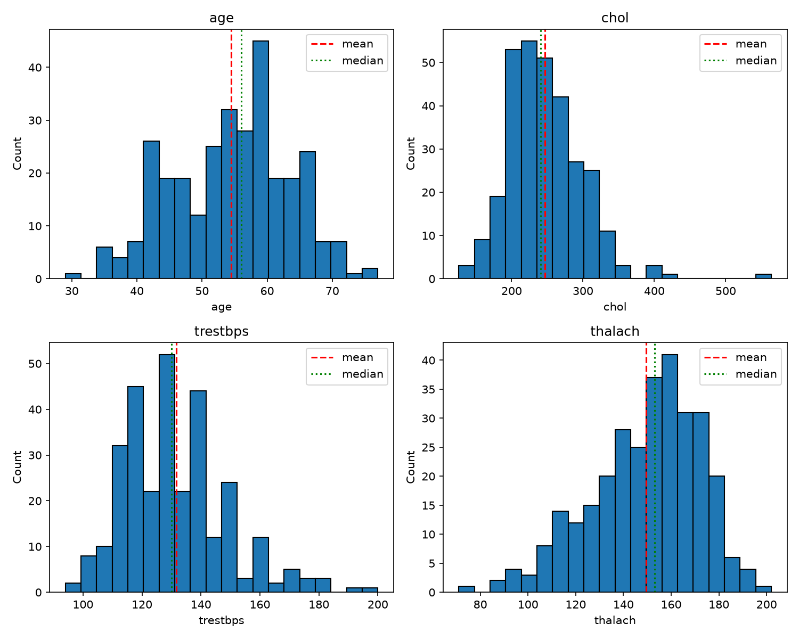
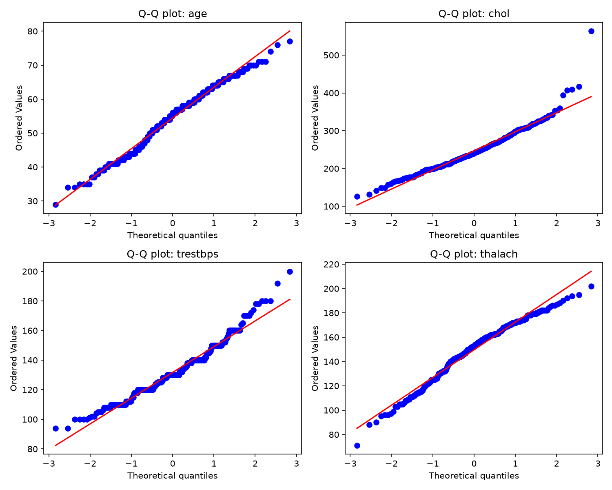
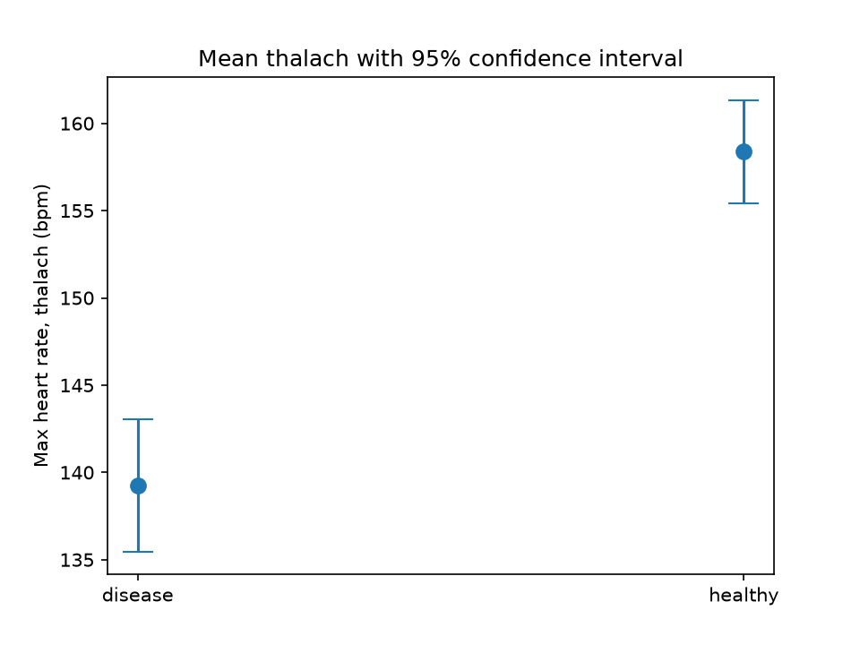
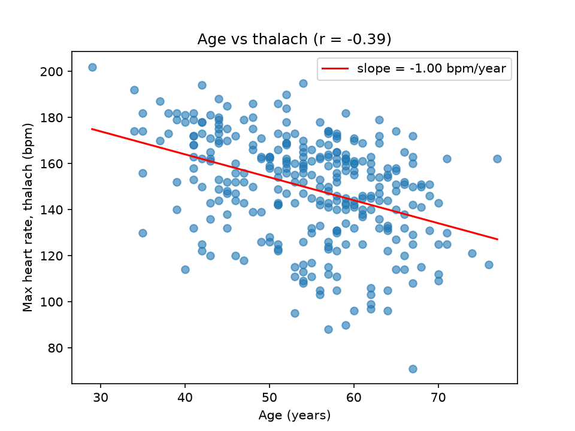
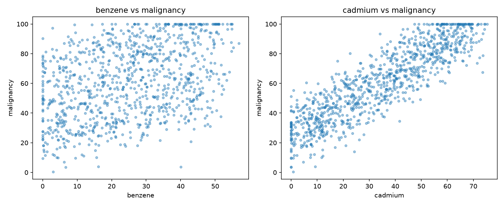
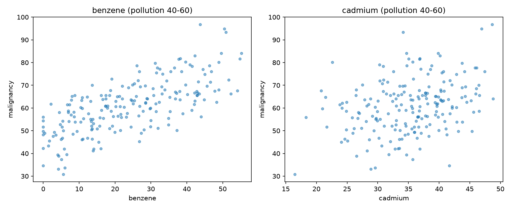

# CSPC - Computer Science for Physics and Chemistry
My coursework repository. Each practical is under PW<n>/Lab <X>/.

## Setup
Create the environment for a given lab:

conda env create -f PW1/Lab\ A/environment.yml
conda activate cspc

## PW1 - Lab A: Reproducible Foundations

**What i built:**
    1. I built my personal CSPC course repository with conda environment.
    2. Decay simulations.
    3. Pytest for testing simulations.
    4. Speed comparison for Numpy and Loop version.

**Speed comparison results:**
    -Loop time: 2.2309
    -NumPy time: 0.0002
    -NumPy is 13083.0x faster than Loop time.

**Test results:**
    -All three tests passed.

**Conclusion:**

    In this PW i learned how to install conda environment and how to work with it. I published my program on GitHub and I also learned how Git branches work. I made a branch, worked on it, committed my changes, and then merged it back into main.

    One problem I had was with my test_matches_law test. it failed the first time because I only used 50 seeds, and the average was not close to the expected value. I fixed it by using more seeds, and then it passed.

## PW1 - Lab B: Data, Plotting, and Automation

**What i built:**
    1. I read the observed decay data (decay_observed.csv) and plotted it next to the analytical decay law N0*exp(-lambda*t), with lambda = 0.3.
    2. I built a 1x2 figure with shared axes, so the observed points and analytical curve are directly comparable.
    3. I automated the figure generation with a Snakemake pipeline (Snakefile).

**Result:**
    The observed data [closely followed / showed noticeable scatter around] the analytical curve, confirming the data is consistent with exponential decay.

**Snakemake pipeline:**
    The Snakefile defines one rule that runs plot.py to build figure.png from decay_observed.csv. It compares file timestamps, so it only reruns plot.py when the CSV (or missing output) makes the figure out of date, and does nothing when nothing changed.

**Conclusion:**

    In this PW i learned how to read a CSV file into NumPy arrays and plot real data against a theoretical model using shared axes for a fair comparison. I also learned how Snakemake pipelines work: defining rules with input, output and shell, and how it uses timestamps to avoid rerunning steps that are already up to date.

    One problem I had was installing snakemake with conda, since it was not found in the conda-forge channel on its own. I fixed it by installing matplotlib with conda and snakemake with pip instead.

## PW2 --- Lab A

**Mean acceleration:**
-8.58 m/s² (std 28.7 m/s²). This is consistent with -9.81 m/s²
within the sampling uncertainty, because the noise is so large.

**Why the acceleration is noisy:**
each derivative divides the small difference between
neighbouring noisy measurements by the tiny time step (0.1 s), which amplifies the noise,
and I did this twice, while the position itself was never differentiated.

**Integrating back:**
integrating the noisy acceleration twice recovered the position to
within 0.78 m of the original. Integration sums many values, so the random noise largely
cancels. Differentiation amplifies noise; integration suppresses it.

**Bonus (2D trajectory):** I differentiated x and y separately with `np.gradient` and
combined them into the speed sqrt(vx² + vy²). The path is smooth, but the speed is noisy
because it comes from a derivative of noisy positions.

## PW2 --- Lab B

**What i built:**
    1. I compared gradient descent, Newton's method and SLSQP on an easy function and a harder one (warmup.py).
    2. I fitted the rate constant of a first-order reaction to noisy data (kinetics.py).
    3. I found the equilibrium of H2 + I2 <=> 2 HI in two ways (equilibrium.py).
    4. Bonus: I located a titration's equivalence point from the slope of the pH curve (titration.py).

**Part 2: three methods:**
    -On f(x) = (x-3)^2 + 1, all three methods reach x = 3.
    -On g(x) = x^4 - 3x^2 + x + 5 they disagree. From x0 = 0, gradient descent and SLSQP find the global minimum at x = -1.30, but Newton lands on x = 0.17, which is a maximum (g'' < 0), because Newton only finds stationary points.
    -From x0 = 2, gradient descent and Newton get stuck in the local minimum at x = 1.13 (g'' > 0), while SLSQP reaches the global minimum at x = -1.30.
    -So on a complicated landscape, the starting point and the algorithm both change the result.

**Part 3: reaction rate:**
    -Fitted k = 0.262 (expected about 0.25).
    -The difference comes from measurement noise, including noise in the first point used as C0.

**Part 4: equilibrium (K = 15.6):**
    -Newton and SLSQP agree: x = 0.664.
    -H2 = I2 = 0.336 mol and HI = 1.328 mol.

**Part 5 (bonus): titration:**
    -The equivalence point is at 50.0 mL, where the pH curve jumps and its slope is largest.

**Conclusion:**

    In this PW i learned that optimization appears all over chemistry: fitting a rate constant, solving for an equilibrium, and finding a titration's equivalence point. I learned that on a simple convex function every method works, but on a complicated one the starting point and the algorithm matter, and that Newton's method can land on a maximum, so I have to check the sign of the second derivative. I also saw that the same equilibrium can be found by root-finding (Newton) or by minimizing the squared imbalance (SLSQP).

    One problem I had was with equilibrium.py: the return line of my function was not indented, which gave an IndentationError, and I fixed it by indenting it. I also first ran the scripts from the wrong folder, and I fixed it by moving into PW2/Lab B before running them.

## PW3 --- Session 1

**Data:** Cleveland Heart Disease dataset (UCI / Kaggle, ritwikb3/heart-disease-cleveland), 303 patients, 14 columns. I used age, chol, trestbps and thalach.

**Shapes:**
    -age: broad and lumpy with several peaks, slightly longer on the young side.
    -chol: one peak near 230 with a long right tail and an outlier at 564.
    -trestbps: one peak around 120-140, mild right tail.
    -thalach: one peak around 160-170, longer left tail.

**Normality verdicts (histogram, skew, kurtosis, Shapiro-Wilk, Q-Q plot):**
    -age: approximately normal (skew -0.21, but Shapiro p = 0.006 because n is large).
    -chol: not normal (skew 1.13, kurtosis 4.4, Shapiro p ~ 0, Q-Q curves at the right end).
    -trestbps: not normal (skew 0.70, Shapiro p ~ 0).
    -thalach: approximately normal with mild left skew (skew -0.53, kurtosis -0.07, Shapiro p = 0.00007).

**Reasoning:** with 303 points Shapiro rejects even small deviations, so I also used skew, kurtosis and the Q-Q plots.

## PW3 --- Session 2

**Heart rate comparison:** thalach was roughly normal, so I used Welch's t-test (no equal-variance assumption) and checked it with Mann-Whitney, which doesn't assume normality.
    -Disease: mean 139.3 bpm (95% CI ±3.8), n = 139.
    -Healthy: mean 158.4 bpm (95% CI ±3.0), n = 164.
    -Welch t = -7.86, p = 9e-14; Mann-Whitney p = 2e-13.
    -Conclusion: the groups genuinely differ; patients with heart disease reach about 19 bpm lower maximum heart rate. The confidence intervals do not overlap, which agrees with the tests.

**Age vs heart rate:** Pearson r = -0.39 and Spearman rho = -0.39 (both p ~ 1e-12). Older patients reach a lower maximum heart rate, about 1 bpm less per year of age. The relationship is moderate: age explains only about 16% of the variation in thalach.

## PW3 --- Chemical mystery

**Naive analysis (all 1000 patients):** benzene r = 0.385, cadmium r = 0.880 (Spearman agrees). Taken at face value, cadmium appears to be the cause of malignancy.

## PW3 --- Chemical mystery

**Naive analysis (all 1000 patients):** benzene r = 0.385, cadmium r = 0.880 (Spearman agrees). Taken at face value, cadmium appears to be the cause of malignancy.

**Look again:** the correlation table shows pollution_index is linked to cadmium (r = 0.98) and to malignancy (r = 0.90), but not to benzene (r = 0.05). So pollution could be a confounder: it drives both cadmium and malignancy. Age is not (all its correlations are about 0).

**Test:** I restricted to patients with similar pollution and recomputed, and I also computed the partial correlation (pollution removed from both variables).
    -Pollution 40-60 (n = 199): benzene r = 0.70, cadmium r = 0.32.
    -Pollution 45-55 (n = 94): benzene r = 0.66, cadmium r = -0.04 (p = 0.70).
    -Partial correlation: benzene r = 0.755, cadmium r = 0.013 (p = 0.69).

**Conclusion:** benzene is the real cause. Its association survives and gets stronger when pollution is controlled. Cadmium only looked guilty because it rises with pollution, and its association disappears once pollution is held constant. The wide 40-60 band still shows some cadmium effect because pollution still varies inside it; the narrower band removes it.

**Bonus (entropy of target):** proportions are 54.1% healthy and 45.9% disease, giving an entropy of 0.995 bits (maximum for two classes is 1 bit). The column is almost perfectly balanced, so the category is about as hard to guess as a fair coin; always guessing "healthy" would be right only 54% of the time.